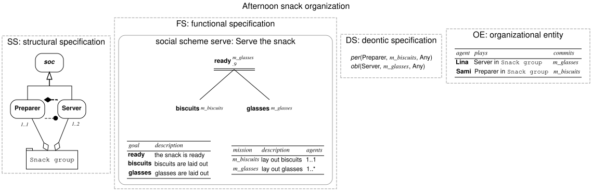
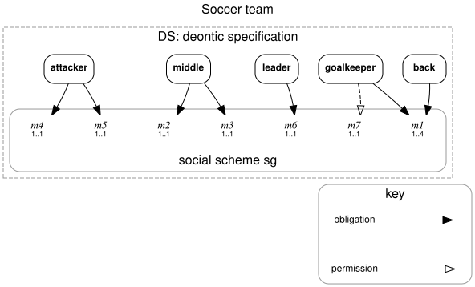
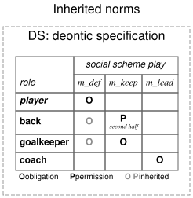
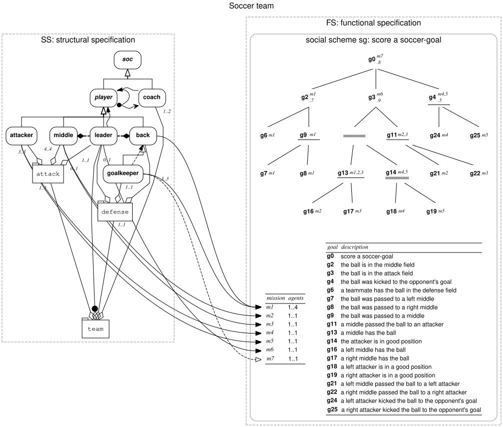

# MOISE Diagram language reference

MOISE Diagram is a PlantUML-like text language for writing **MOISE+ organizational specifications** as they are defined in:

> J. F. Hübner, J. S. Sichman, O. Boissier. *A Model for the Structural, Functional, and Deontic Specification of Organizations in Multiagent Systems.* SBIA 2002, LNCS 2507, Springer.

A UTF-8 `.moise` file declares an organizational specification (OS) and, optionally, an organizational entity (OE). The compiler checks the file against the rules of the paper and draws it with the paper's graphical notation. The structural specification is drawn like **Fig. 2** and the social schemes like **Fig. 3**, with a goal table like **Table 1**.

This document is the complete reference. For installation and the Python API, see [README.md](README.md) and [docs/api.md](docs/api.md).

## Contents

- [From the paper to the language](#from-the-paper-to-the-language)
- [A first example](#a-first-example)
- [File structure and lexical rules](#file-structure-and-lexical-rules)
- [Statement summary](#statement-summary)
- [Structural specification (SS)](#structural-specification-ss)
- [Functional specification (FS)](#functional-specification-fs)
- [Deontic specification (DS)](#deontic-specification-ds)
- [Organizational entity (OE)](#organizational-entity-oe)
- [Graphical notation](#graphical-notation)
- [Validation rules and error messages](#validation-rules-and-error-messages)
- [Differences from the paper and limitations](#differences-from-the-paper-and-limitations)
- [Migrating from version 0.1](#migrating-from-version-01)

## From the paper to the language

| Paper | Notation in the paper | Statement |
| --- | --- | --- |
| Role, abstract role (R<sub>abs</sub>) | ρ | `role id ["label"] [abstract]` |
| Root role | ρ<sub>soc</sub> | predefined as `soc` |
| Inheritance | ρ ⊏ ρ′ (ρ′ specializes ρ) | `inherits ρ′ ρ` |
| Group specification | gt = ⟨R, SG, L<sup>intra</sup>, L<sup>inter</sup>, C<sup>intra</sup>, C<sup>inter</sup>, np, ng⟩ | `group id ["label"]` |
| Role in a group, with its cardinality | ρ ∈ R, np(ρ) = (min, max) | `contains gt ρ [min..max]` |
| Sub-group, with its cardinality | gt′ ∈ SG, ng(gt′) = (min, max) | `contains gt gt′ [min..max]` |
| Role counted in sub-groups ("sub-groups scope" in Fig. 2) | np(ρ) on a role played in sub-groups | `contains gt ρ [min..max] subgroups` |
| Link | link(ρ<sub>s</sub>, ρ<sub>d</sub>, t) ∈ L<sup>intra</sup> or L<sup>inter</sup> | `link gt ρs ρd acq\|com\|aut intra\|inter` |
| Compatibility | ρ<sub>a</sub> ⋈ ρ<sub>b</sub> ∈ C<sup>intra</sup> or C<sup>inter</sup> | `compat gt ρa ρb intra\|inter` |
| Social scheme | SCH = ⟨G, M, P, mo, nm⟩ | `scheme id root_goal ["label"]` |
| Goal | g ∈ G | `goal id ["label"]` |
| Plan, with its success degree | g<sub>2</sub> =<sub>0.85</sub> g<sub>6</sub>, (g<sub>7</sub> \| g<sub>8</sub>) | `plan g2 =0.85 g6, (g7 \| g8)` |
| Mission and its cardinality | m ∈ M, nm(m) = (min, max) | `mission id ["label"] [min..max]` |
| Goals of a mission | mo(m) = {g, …} | `goals m g …` |
| Mission preference | m<sub>1</sub> ≺ m<sub>2</sub> | `prefer m1 m2` |
| Permission, obligation | per(ρ, m, tc), obl(ρ, m, tc) | `per ρ m [tc]`, `obl ρ m [tc]` |
| Agent, role adoption, mission commitment (OE) | — | `agent`, `plays`, `commits` |

## A first example

[`examples/snack.moise`](examples/snack.moise) uses all four views on a small scale:

```text
@moise "Afternoon snack organization"

# Structural specification
role preparer "Preparer"
role server "Server"
group snack "Snack group"
contains snack preparer 1..1
contains snack server 1..2
link snack preparer server com intra
compat snack server preparer intra

# Functional specification
scheme serve ready "Serve the snack"
goal ready "the snack is ready"
goal biscuits "biscuits are laid out"
goal glasses "glasses are laid out"
plan ready =0.9 biscuits || glasses
mission m_biscuits "lay out biscuits" 1..1
mission m_glasses "lay out glasses"
goals m_biscuits biscuits
goals m_glasses glasses ready

# Deontic specification
per preparer m_biscuits Any
obl server m_glasses Any

# Organizational entity
agent lina "Lina"
agent sami "Sami"
plays lina server snack
plays sami preparer snack
commits lina m_glasses
commits sami m_biscuits
@end
```



[`examples/soccer.moise`](examples/soccer.moise) transcribes the paper's soccer team: Fig. 2, Fig. 3, Table 1 and the deontic specification of Section 4. Here are its structural and functional views, each with its key (`--key`):


## File structure and lexical rules

- **Document delimiters.** Every statement must appear between a single `@moise ["title"]` line and an `@end` line. Blank lines and comments may appear anywhere, including outside the delimiters. Without a title, the diagram is titled `MOISE+`.
- **One statement per line.** A statement cannot span several lines.
- **Words and strings.** Words are separated by whitespace. Labels containing spaces or punctuation are quoted with `"…"` (where `\"` is a literal quote) or with `'…'`. Non-ASCII characters are allowed in labels; save files as UTF-8.
- **Punctuation.** `(`, `)`, `,`, `|`, `||`, `∥` and `=` are tokens of their own and are only meaningful in `plan`. Elsewhere they are errors, so quote any label that contains them.
- **Comments.** `#` starts a comment that runs to the end of the line, unless it is inside quotes. A `#` inside an unquoted word also starts a comment.
- **Identifiers.** Identifiers must match `[A-Za-z_][A-Za-z_0-9]*` and are case-sensitive. Roles, groups, goals, missions, schemes and agents share one namespace. Identifiers beginning with `__` are reserved, and `soc` is the predefined root role.
- **Order independence.** All declarations are read before any other statement, so a statement may reference an element that is declared further down the file.
- **Keywords.** Keywords and option values (`abstract`, `subgroups`, `intra`, …) are lowercase. A quoted word is always a label, never a keyword: `role r "abstract"` declares a concrete role labeled *abstract*.

## Statement summary

In the syntax column, `[x]` means optional and `a|b` means "one of".

| Statement | Meaning |
| --- | --- |
| `@moise ["title"]` … `@end` | Document delimiters |
| **Structural specification** | |
| `role id ["label"] [abstract]` | Role, optionally abstract |
| `inherits sub parent` | `sub` specializes `parent` |
| `group id ["label"]` | Group specification |
| `contains group role [min..max] [subgroups]` | Role of a group, with cardinality (default `0..*`) |
| `contains group subgroup [min..max]` | Sub-group, with cardinality (default `0..*`) |
| `link group source target acq\|com\|aut intra\|inter` | Link between roles |
| `compat group role_a role_b intra\|inter` | Compatibility between roles |
| **Functional specification** | |
| `scheme id root_goal ["label"]` | Social scheme rooted at a goal |
| `goal id ["label"]` | Goal; the label is its description |
| `plan goal =[rate] expression` | Decomposition of a goal |
| `mission id ["label"] [min..max]` | Mission, with agent cardinality (default `1..*`) |
| `goals mission goal1 [goal2 ...]` | Goals of a mission |
| `prefer better worse` | Mission preference |
| **Deontic specification** | |
| `per role mission [time_constraint]` | Permission (default `Any`) |
| `obl role mission [time_constraint]` | Obligation (default `Any`) |
| **Organizational entity** | |
| `agent id ["label"]` | Agent |
| `plays agent role group` | The agent adopts a role in a group |
| `commits agent mission` | The agent commits to a mission |

## Structural specification (SS)

The SS has three levels: the individual level (roles), the social level (links) and the collective level (groups, compatibilities and cardinalities).

### Roles and inheritance

```text
role player abstract
role coach "Coach"
inherits back player          # back specializes player
inherits goalkeeper back      # the paper writes ρback ⊏ ρgoalkeeper
```

- An **abstract role** exists only for specification purposes: it cannot be played by an agent, so it cannot appear in `contains` or `plays`.
- **`soc`** is predefined. It is the abstract root of the hierarchy: every role without an explicit `inherits` specializes `soc` directly. You may still write `inherits r soc` explicitly. `soc` cannot be declared and cannot inherit.
- A role may specialize **several** roles (multiple inheritance). The inheritance relation must be acyclic, and a role cannot inherit from itself.
- A sub-role inherits its parents' links (paper equations 3–4), compatibilities (equation 5) and deontic relations (equations 8–9). The compiler applies inheritance when it checks the organizational entity.

### Groups and cardinalities

```text
group team
group defense
contains team coach 1..2
contains team defense 1..1              # defense is a sub-group of team
contains team leader 1..1 subgroups     # one leader somewhere in team's sub-groups
contains defense goalkeeper 1..1
contains defense back 3..3
contains defense leader 0..1
```

A `group` declares a group specification. `contains` fills its sets and cardinality functions:

- `contains gt ρ min..max` adds the role ρ to R<sub>gt</sub> and sets np<sub>gt</sub>(ρ). Only non-abstract roles are allowed.
- `contains gt gt′ min..max` adds gt′ to the sub-groups SG<sub>gt</sub> and sets ng<sub>gt</sub>(gt′). A group that is not a sub-group of any other group is a *root group specification*.
- A cardinality is `min..max`, where `max` may be `*` (unbounded). The paper's default is (0, ∞), so an omitted cardinality is `0..*`.
- The trailing **`subgroups`** flag expresses the paper's *sub-groups scope*: the cardinality counts agents playing the role in the group's sub-groups. For example, a team needs one leader, who plays in the defense or the attack group. A role marked this way is not in R<sub>gt</sub>, so `plays a leader team` is rejected.

Composition must be acyclic. A group cannot contain itself, and the same member cannot be listed twice in the same group.

### Links

```text
link team coach player aut inter
link defense goalkeeper back aut intra
```

`link gt source target type scope` adds link(source, target, type) to L<sup>intra</sup><sub>gt</sub> or L<sup>inter</sup><sub>gt</sub>.

| Type | Meaning |
| --- | --- |
| `acq` | Acquaintance: agents playing `source` may have a representation of agents playing `target` |
| `com` | Communication: they may communicate with them |
| `aut` | Authority: they have authority over them |

| Scope | Meaning |
| --- | --- |
| `intra` | Applies to agents in the same group, or in one of its sub-groups |
| `inter` | Applies regardless of the groups the agents belong to |

Links are drawn as written. The implications aut ⇒ com ⇒ acq and the inheritance of links by sub-roles are part of the model's semantics and are not drawn as extra edges.

### Compatibilities

```text
compat defense leader back intra
```

`compat gt ρa ρb scope` states ρ<sub>a</sub> ⋈ ρ<sub>b</sub>: an agent playing ρ<sub>a</sub> may also play ρ<sub>b</sub>. The scope works as for links: `intra` means in the same group or a sub-group, and `inter` means in another group. Compatibility is reflexive and transitive, so `compat g r r` is an error. Roles that are not declared compatible are incompatible. Compatibilities are used to check `plays` statements (see [Organizational entity](#organizational-entity-oe)).

## Functional specification (FS)

The FS is a set of social schemes and mission preferences.

### Social schemes and goals

```text
scheme sg g0 "score a soccer-goal"
goal g0 "score a soccer-goal"
goal g2 "the ball is in the middle field"
```

A `scheme` declares a social scheme and its root goal. Its goal set G is the root plus every goal reachable through plans. Every declared goal must belong to exactly one scheme, and the root goal cannot be a subgoal of another goal. A goal's label is its description: it is shown in the scheme's goal table (like Table 1 of the paper), while the tree shows identifiers.

### Plans

```text
plan g0 =0.8 g2, g3, g4
plan g9 = g7 | g8
plan g3 =0.9 (g13 || g14), g11
```

A plan decomposes a goal with one of three operators:

| Operator | Written | Meaning |
| --- | --- | --- |
| sequence | `,` | Achieve the subgoals one after another, in the order given |
| choice | `\|` | Achieve one, and only one, of the subgoals |
| parallelism | `\|\|` or `∥` | Achieve all subgoals, possibly in parallel |

- The optional number right after `=` is the plan's **success degree**, between 0 (excluded) and 1. The paper writes it as a subscript on `=`, and the diagram shows it under the goal.
- Parentheses nest operators: `g2 = g6, (g7 | g8)`. Each parenthesized group becomes an **anonymous goal**, drawn as in Fig. 3: an unlabeled junction carrying the operator's bars. Different operators cannot be mixed at one level without parentheses, and every level needs at least two subgoals.
- Plans form a **tree**. A goal has at most one plan, and a goal is a subgoal of at most one goal. Decomposition must be acyclic.

### Missions

```text
mission m1 1..4
mission m2 "pass to the attackers" 1..1
goals m1 g2 g6 g9 g7 g8 g13
goals m2 g13 g11 g16 g21
prefer m1 m2
```

- A mission is a set of goals that an agent commits to as a whole: mo(m) is given by one or more `goals` statements. Every mission needs at least one goal, and all its goals must belong to the same scheme.
- The optional cardinality is nm(m): how many agents must commit to the mission for the scheme to be well formed. The paper's default is (1, ∞), so an omitted cardinality is `1..*`.
- `prefer m1 m2` states m<sub>1</sub> ≺ m<sub>2</sub>: an agent permitted to commit to both missions should give priority to m<sub>1</sub>. The missions may belong to different schemes. Preferences must be acyclic.

## Deontic specification (DS)

```text
per goalkeeper m7 Any
obl back m1 Any
```

- `per ρ m tc`: agents playing ρ are **permitted** to commit to m.
- `obl ρ m tc`: agents playing ρ are **obliged** to commit to m. An obligation implies a permission (equation 7).
- The time constraint `tc` is the set of periods during which the norm is valid. `Any` (the default) means "every day, all hours". Any other value is kept as an opaque label, and must be quoted if it contains spaces: `per coach m_sub "Sundays/14h-16h"`.
- Deontic relations are inherited by sub-roles (equations 8–9). For example, `obl player m1` also applies to `back` and `goalkeeper`.

## Organizational entity (OE)

```text
agent lina "Lina"
plays lina server snack
commits lina m_glasses
```

The OE describes a population of agents at one point in time. Each group specification is treated as **one group instance**. The compiler checks the OE against the OS:

- **`plays a ρ gt`.** ρ must be a non-abstract role of R<sub>gt</sub>: it must be declared by `contains gt ρ` without `subgroups`. An agent cannot play the same role twice in the same group.
- **Compatibility.** When an agent plays two different roles, they must be compatible:
  - When both groups are the same, or one is a sub-group of the other, an `intra` compatibility is needed. It must be declared in a group that contains both of them.
  - Otherwise, an `inter` compatibility is needed. It must be declared in one of the two groups or in one of their ancestors.
  - Compatibility is transitive, can be used in either direction, and is inherited by sub-roles. Following the paper's example, `leader ⋈ back` also lets the leader be the goalkeeper because back ⊏ goalkeeper. Playing the same role in two groups is always allowed (reflexivity).
- **`commits a m`.** One of the roles the agent plays (or one of their ancestors) must have a `per` or an `obl` on m.

Group and scheme **well-formedness** (cardinalities np, ng and nm) is *not* checked. An OE is a snapshot, and organizations are routinely incomplete while agents join. To show change over time, keep one specification and compile several files with different OE statements.

## Graphical notation

By default, all four specifications are drawn in one diagram, each in its own panel. Select some of them with `--view ss|fs|ds|oe` (repeatable) or `to_dot(model, views=[...])`. Add the legends with `--key`. The deontic specification has three styles and an integrated mode, described [below](#deontic-specification).

### Structural specification (Fig. 2)

| Element | Rendering |
| --- | --- |
| Role | Rounded box, bold label |
| Abstract role (including `soc`) | Rounded box, bold italic label |
| Group | Folder ("tab") shape, monospace label |
| Inheritance | Right-angled "bus" lines: a trunk under the parent with a single hollow triangle, a horizontal bar shared by all its sub-roles, and a vertical drop to each one; parents are drawn above sub-roles |
| Composition | Solid line with a hollow diamond at the group; the italic cardinality is next to the member, placed so that it overlaps no node, line or other cardinality, and is closer to its own line than to any other |
| Sub-groups scope | A filled dot before the composition diamond |
| `acq` link | Open arrowhead |
| `com` link | Filled dot |
| `aut` link | Filled arrowhead |
| `compat` | Thick line with a filled diamond |
| Scope | Dashed line for `intra`, wavy line for `inter` (for links and compatibilities alike) |

### Functional specification (Fig. 3, Table 1)

Each social scheme is drawn in its own rounded panel.

| Element | Rendering |
| --- | --- |
| Goal | Bold identifier. Missions containing the goal are shown in superscript italics, compressed as in the paper (`m1,2,3` for m1, m2, m3), and the plan's success degree in subscript (`.8`) |
| Sequence | Plain lines from the goal to its subgoals, ordered left to right |
| Choice | One horizontal bar under the goal |
| Parallelism | Two horizontal bars under the goal |
| Anonymous goal | Just the bars, or a small dot for a sequence |
| Goal table | Identifier and description of each labeled goal (like Table 1), below the tree |
| Mission table | Identifier, description (when any mission has one) and agent cardinality nm |
| Preferences | `m1 ≺ m2` list in the FS panel |

### Deontic specification

The paper writes the DS only as sets of predicates and gives it no graphical notation. The default `list` style follows the paper. The other renderings are conventions of this tool; they reuse the paper's symbols for roles (Fig. 2) and missions (Fig. 3).

| Option | Rendering |
| --- | --- |
| `--ds-style list` (default) | One `per(role, mission, tc)` or `obl(role, mission, tc)` line per norm, permissions first, as in Section 4 of the paper |
| `--ds-style graph` | Roles in a row above the missions, which are grouped by social scheme and annotated with their cardinality nm. Each norm is an edge from a role to a mission |
| `--ds-style matrix` | A table with one row per role and one column per mission (grouped by scheme). Each cell holds the strongest norm, `O` (obligation) or `P` (permission), and any time constraint other than `Any` |
| `--ds-inherited` | Adds the norms that roles inherit from the roles they specialize (equations 8–9), drawn in grey. In the list, each one says which role it comes from. In the matrix, a cell is grey when its norm is only inherited |
| `--ds-links` | Integrated mode, which requires both the `ss` and `fs` views. Each norm is drawn as a curve from the role in the structural view to its mission's row in the missions table of the functional view. This shows how the DS connects the two specifications (Fig. 1 of the paper). It works with any `--ds-style` and with `--ds-inherited` |

In the graph and the integrated mode, edges follow these conventions:

| Norm | Edge |
| --- | --- |
| Obligation | Solid line, filled arrowhead |
| Permission | Dashed line, open arrowhead (the weaker norm gets the lighter line) |
| Inherited norm | The same line, in grey |
| Time constraint other than `Any` | Italic label on the edge |

`--key` adds a legend for these edges.

Graph of the soccer team's DS (`--view ds --ds-style graph --key`):



Matrix with inherited norms for [`examples/deontic.moise`](examples/deontic.moise) (`--view ds --ds-style matrix --ds-inherited`). `back` and `goalkeeper` inherit the obligation on `m_def` from `player`:



Integrated mode for the soccer team (`--view ss --view fs --ds-links`):



The integrated mode reads best on small and medium organizations. With many norms, the graph or the matrix is clearer.

### Organizational entity

The OE panel is a table listing, for each agent, the roles it plays in each group and the missions it is committed to.

## Validation rules and error messages

`parse` stops at the first problem and raises `DiagramError`. Every message starts with `line N:`, except for a missing `@end`. The command-line tool prints `SOURCE: message` and exits with status 2.

| Message | Cause |
| --- | --- |
| **Document** | |
| `unterminated string` | A quote is not closed on its line |
| `expected a single @moise ["title"]` | A second `@moise`, or extra words on the `@moise` line |
| `statement outside @moise ... @end` | A statement before `@moise` or after `@end` |
| `expected @moise ... @end` | `@end` is missing, or the file has no statements at all |
| `unknown or malformed statement: CMD` | Unknown keyword, or wrong number of arguments |
| `unexpected "X"; quote labels containing ( ) , \| =` | Punctuation outside a `plan` |
| **Declarations** | |
| `identifier must match [A-Za-z_][A-Za-z_0-9]*` | Invalid identifier |
| `identifiers beginning with __ are reserved` | Identifier starts with `__` |
| `soc is the predefined root role and cannot be declared` | `role soc` or any other declaration of `soc` |
| `duplicate identifier X` | `X` is already declared, whatever its kind |
| `only a role can be abstract` | `abstract` on another kind of declaration |
| `expected KIND id ["label"] ...` | Too many words in a declaration |
| `expected scheme id root_goal ["label"]` | Malformed `scheme` |
| `X must reference KIND` | `X` is undeclared or has the wrong kind |
| **Structural specification** | |
| `expected cardinality min..max or min..*` | Cardinality syntax error |
| `cardinality minimum exceeds maximum` | For example, `2..1` |
| `abstract role X cannot be played in a group` | `contains` with an abstract role |
| `the subgroups scope only applies to roles` | `subgroups` on a sub-group |
| `group G cannot contain itself` / `X is already part of group G` | Invalid or duplicate composition |
| `expected link group source target acq\|com\|aut intra\|inter` | Unknown link type or scope (`compat` is a separate statement) |
| `expected compat group role_a role_b intra\|inter` | Unknown compatibility scope |
| `compatibility is reflexive: ...` | `compat` between a role and itself |
| `role X cannot inherit from itself` / `soc is the root role and cannot inherit` / `duplicate inheritance` | Invalid inheritance |
| `cycle in inheritance involving X` / `cycle in group composition involving X` | Cyclic hierarchy |
| **Functional specification** | |
| `expected plan goal =[rate] subgoal op subgoal ...` | Missing `=` |
| `success rate must be in (0, 1]` | Out-of-range success degree |
| `a plan needs at least two subgoals` | A plan with a single subgoal |
| `mixing plan operators requires parentheses` | For example, `a, b \| c` |
| `missing ) in plan` / `unexpected "X" in plan` / `incomplete plan` | Malformed expression |
| `goal X already has a plan` | Second plan for the same goal |
| `goal X is already a subgoal of Y` / `goal X cannot be its own subgoal` | The plans do not form a tree |
| `cycle in goal decomposition involving X` | Cyclic plans |
| `root goal X of scheme S is a subgoal of Y` | A scheme rooted below another goal |
| `goal X is already the root of scheme S` | Two schemes with the same root |
| `goal X is not part of any social scheme` | Goal unreachable from every scheme root |
| `mission M has no goals` | Mission without `goals` |
| `mission M mixes goals of schemes S and T` | A mission's goals span several schemes |
| `goal X is already in mission M` | Duplicate goal in a mission |
| `a mission cannot be preferred to itself` / `cycle in mission preference involving M` | Invalid preferences |
| **Organizational entity** | |
| `abstract role X cannot be played` | `plays` with an abstract role |
| `role X is not part of group G` | The role is not in R<sub>G</sub> |
| `A already plays X in G` | Duplicate `plays` |
| `A cannot play both X in G and Y in H: roles are not compatible` | Missing compatibility |
| `A cannot commit to M: none of its roles has a permission or obligation for it` | Unauthorized commitment |

## Differences from the paper and limitations

- **Rendering pipeline.** Graphviz has no wavy lines, shared bus lines or collision-free edge labels, so the compiler lays out the diagram with `dot`, redraws those elements itself, and renders the result with `neato -n2` (see [docs/internals.md](docs/internals.md#rendering-pipeline)). The `.dot` output is the source before this step: rendering it directly with `dot` gives plain solid lines and Graphviz's own label placement.
- **Layout.** Element positions are computed by Graphviz, so they differ from the hand-drawn figures.
- **Panels, DS and OE.** The dimension panels, the `graph` and `matrix` styles of the DS, the integrated `--ds-links` mode and the OE table are conventions of this tool. The paper gives the DS only as predicate lists (the default `list` style), and it defines the OE without giving it a graphical notation.
- **Group instances.** The OE treats each group specification as a single group instance, and each scheme as a single scheme instance.
- **Not checked:**
  - well-formedness of groups and schemes (np, ng, nm);
  - time constraints, which are displayed but never evaluated;
  - mission preferences at run time;
  - whether goals are achieved.
- **Implied facts.** Implied links (aut ⇒ com ⇒ acq), inherited links and inherited norms are part of the semantics and are used in the checks, but they are not drawn.

## Migrating from version 0.1

Version 0.2 aligns the language with the paper. These changes break 0.1 files:

| 0.1 | 0.2 |
| --- | --- |
| `link com a b intra` | `link GROUP a b com intra`: links belong to a group specification |
| `link compat a b intra` | `compat GROUP a b intra`: compatibility is not a link |
| `plan g parallel a b` | `plan g = a \|\| b` (also `,` for sequence and `\|` for choice) |
| Goals outside any scheme | Every goal must belong to a `scheme id root_goal` |
| `contains g r` required a cardinality | Optional; defaults to `0..*` |
| Abstract roles could be composed and played | Rejected, as in the paper |
| `plays` and `commits` were only checked for kinds | Group membership, compatibilities and permissions are checked |
