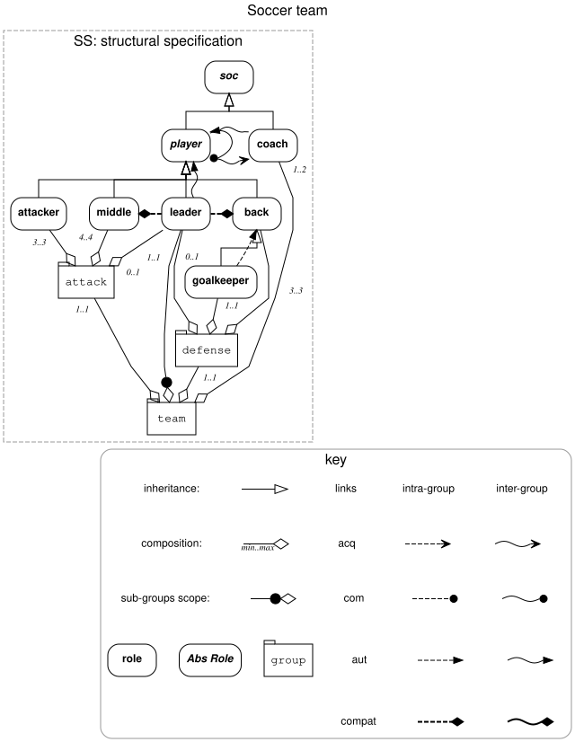
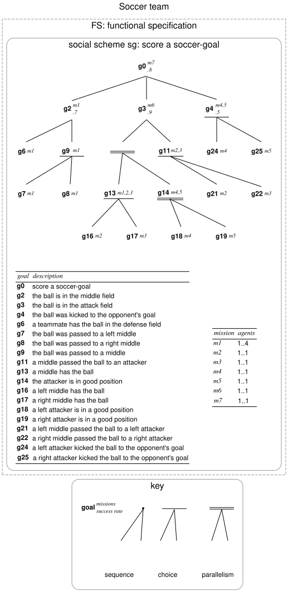

# MOISE Diagram

A small, self-contained Python package for writing **MOISE+ organizational specifications** in a PlantUML-like text language, checking them against the MOISE+ model, and drawing them with the paper's graphical notation through Graphviz.

The language and the diagrams follow the reference paper:

> J. F. Hübner, J. S. Sichman, O. Boissier. *A Model for the Structural, Functional, and Deontic Specification of Organizations in Multiagent Systems.* Advances in Artificial Intelligence (SBIA 2002), LNCS 2507, Springer, 2002.

```text
@moise "Soccer team"
role player abstract
role back
inherits back player
group defense
contains defense back 3..3
link defense goalkeeper back aut intra
...
scheme sg g0 "score a soccer-goal"
plan g0 =0.8 g2, g3, g4
plan g9 = g7 | g8
...
obl back m1 Any
@end
```

| Structural specification (paper Fig. 2) | Social scheme (paper Fig. 3) |
| --- | --- |
|  |  |

Both diagrams are generated from [`examples/soccer.moise`](examples/soccer.moise), a transcription of the paper's running example.

## Features

- **The whole MOISE+ model:**
  - **Structural:** roles, abstract roles and the root role `soc`, multiple inheritance, group specifications with role and sub-group cardinalities, intra- and inter-group links (`acq`, `com`, `aut`) and compatibilities.
  - **Functional:** social schemes, goals, plans with sequence, choice and parallelism, success degrees and nested anonymous goals, missions with cardinalities, and mission preferences.
  - **Deontic:** permissions and obligations with time constraints.
- **The paper's notation.** The structural view looks like Fig. 2, with rounded role boxes, folder-shaped groups, right-angled inheritance lines sharing one triangle per parent, diamonds, one arrowhead per link type, and wavy inter-group lines. Cardinalities are placed so that they never overlap. Social schemes look like Fig. 3: missions in superscript, success degrees in subscript, and bars for choice and parallelism. A goal table follows Table 1, and `--key` adds the legends of both figures.
- **Checked against the model.** The compiler rejects, with a line number:
  - malformed or dangling references;
  - abstract roles placed in groups;
  - plans that do not form a tree, and goals outside any social scheme;
  - missions spanning several schemes;
  - cycles.
- **An optional organizational entity.** You can also declare agents, the roles they play and the missions they commit to. The compiler checks that each role belongs to its group and that an agent's roles are compatible. It also checks that each commitment is permitted, taking inheritance into account.
- **No runtime dependencies.** Only the Python standard library is needed (Python ≥ 3.10). Graphviz (`dot` and `neato`) is required for SVG, PNG and PDF output; DOT output works without it.

## Installation

```bash
python -m pip install .                 # from a clone of the repository
python -m pip install -e '.[test]'      # for development
```

To render images, install [Graphviz](https://graphviz.org/download/) and make sure `dot` is on your `PATH`. For example, run `sudo apt install graphviz` on Debian/Ubuntu or `brew install graphviz` on macOS.

## Quick start

### Command line

```bash
moise-diagram examples/soccer.moise -o soccer.svg                         # all specifications
moise-diagram examples/soccer.moise -o structure.svg --view ss --key      # Fig. 2 with its key
moise-diagram examples/soccer.moise -o scheme.pdf --view fs --key         # Fig. 3 with its key
moise-diagram examples/snack.moise -o snack.dot                           # no Graphviz needed
```

The output file's extension selects the format: `.svg`, `.png`, `.pdf` or `.dot`. `--view` takes `ss`, `fs`, `ds` or `oe` and can be repeated. If the source has an error, the command prints `SOURCE: line N: message` to stderr and exits with status 2. `python -m moise_diagram` is equivalent to `moise-diagram`.

### Python

```python
from moise_diagram import parse, to_dot, compile_file

model = parse(open("examples/soccer.moise", encoding="utf-8").read())
print(model.ancestors("goalkeeper"))            # {'goalkeeper', 'back', 'player', 'soc'}
print(to_dot(model, views=["ss"], key=True))    # Graphviz DOT source
compile_file("examples/soccer.moise", "soccer.svg")
```

## Documentation

| Document | Contents |
| --- | --- |
| [LANGUAGE.md](LANGUAGE.md) | Language reference: how the paper maps to statements, the semantics of every statement, the graphical notation, error messages, limitations, and migrating from 0.1 |
| [docs/api.md](docs/api.md) | Python API (model classes, `parse`, `to_dot`, `compile_file`) and command-line reference |
| [docs/internals.md](docs/internals.md) | Architecture, how to extend the language, testing, known issues |

## Scope

MOISE Diagram is a **specification compiler**, not a MOISE+ execution engine. It checks that a specification is well formed and consistent with the model, and draws it. It does not run organizations or check whether goals are achieved. It does not check group or scheme well-formedness (cardinalities) for the organizational entity, and it does not evaluate time constraints. See [LANGUAGE.md](LANGUAGE.md#differences-from-the-paper-and-limitations) for the complete list.

## Development

```bash
python -m pip install -e '.[test]'
python -m pytest -q                         # rendering tests are skipped if Graphviz is missing
python -m pip wheel --no-deps . -w dist     # build a wheel
```

## License

MIT. See [LICENSE](LICENSE).
